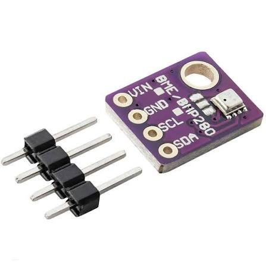

## BME280

This is the BME280. We had to use it so that we can fulfill the primary objective of measuring air temperature and pressure.

## Wiring
* VIN - 3.3V
* GND - GND
* SDA - 3
* SDL - 10

## Problems
* We at first didn't want to solder its pins to itself, but we noticed that else the jumper wires simply wouldn't hold, since they're too small. In the end, we soldered them.
* Our first attempt at soldering was pretty bad. The solder wasn't hot enough to hold the pins in place and it led to faulty connection.
* The second time we had to resolder, since we finally got ourselves a good soldering iron.
* Finally, the wiring worked and the BME280 was function
* We had many issues with getting it to work with our ESP32 C3 supermini. We needed to change the SDA and SCL pins a few times to get them to work.

## Code
The full script `UnifiedSenderScript.ino` can be found in the `Code` folder.

* The code communicates with the BME280 over the SPI protocol.
* In the `setup` function, the protocol is set up `Wire.begin(I2C_SDA, I2C_SCL);`.
* The rest of the code simply uses the BME280 library's functions to get the values of air temperature, pressure, humidity, along with altitude from sea level and from the launching point.