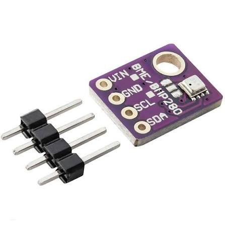

# First Testing of the BME280 Sensor (5th of November 2026)

## The BME280 Sensor
The BME280 is a sensor that measures air temperature, pressure, humidity, and altitude.

## The Experiment
We started the sensor inside of our school and left it there for about 1 minute. Then, we took it outside for about 2 minutes. Afterwards, we put it back inside for about 3 minutes.

## The Results
The sensor works, but it has a few issues. For example, because of its small surface area, its heat dissipation is pretty bad, it taking quite a long time to cool down, though it heated up faster than it cooled down. This means we will have to put the satellite outside for a minute or two before starting measurements.

## Values Graphed
