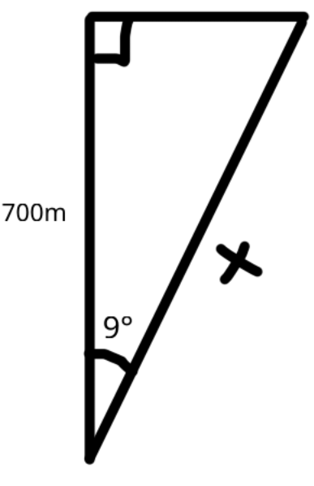
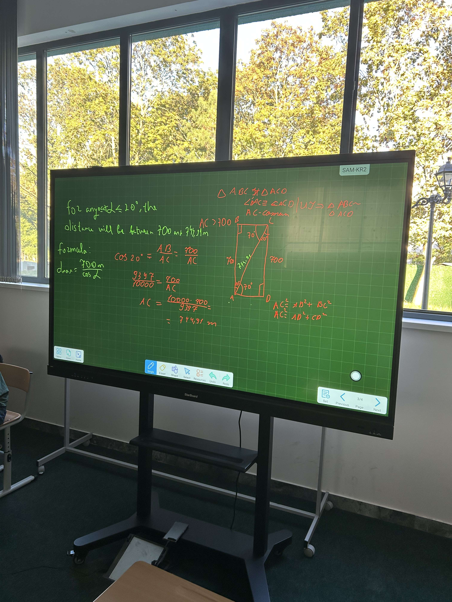
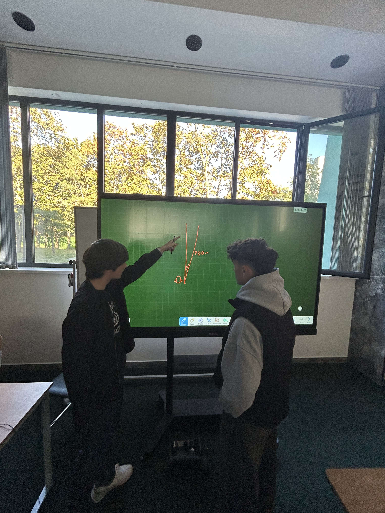

# Distance Calculations
One of the primary objectives of CanSat is being able to know how far apart the satellite is.

# Ideas
We had a few ideas on how to do this, ranging from reasonable to bonkers.
* Our first idea was to simply use a GPS inside of the satellite. This didn't last for long though, since we wanted to do something special.
* We then decided to try to use multiple points of measurements to extrapolate the distance.
* The first one would be trigonometry. We knew the angle that the rocket would fly at, which is $9^\circ$, therefore we could draw a right triangle, with the distance we want to find as the hypothenuse, the long leg as $700m$, since that's the distance it will go up, and the other leg we don't care about.

   
* To find $x$ here, we decided to use simple trigonometrical functions. Let's start with $cos(9^\circ) = 0.98$. $cos$ is also equal to $\frac{Adjacent leg}{Hypothenuse}$, which in this case is $\frac{700m}{x}$. This gives us $cos(9^\circ)=\frac{700m}{x}$, and if we rearrange we end up with $x = \frac{700m}{cos9^\circ}$. If we plug in the values, we end up with $x=708.72m$. This means that if we stand exactly at the launching point, the satellite will be at 708.72m from us at maximum height. Here are some photos of us calculating this:

* From this data point, we wanted to create a circle around the point (right edge of the triangle) to have a radius of where it could be. We didn't have enough info for that though.
* Therefore, the second data point would have to be a gyroscope. We had a few BMI sensors, which measured the sensor's inclinaition. We would need this, since we dont know which direction the satellite is being launched from. It could be launched north, south, east or west. For a good automatic approximation, we would need to also know the direction. The problem is that the BMI sensors are bad and can't actually tell you where the north is. Therefore, we had to throw away our plan.
* We revisited the problem with new eyes and thought "Hey, the LoRa module can tell us how good the signal incoming is. Couldn't we use this to calculate how far away it came from?". We then researched for a bit and found out this: $RSSI \sim \frac{1}{r^2}$. $RSSI$ is the signal strength and $r$ is the distance between the radii of the object. This is the inverse square law, meaning that the signal decays proportionally to the distance squared.
* We then researched some more and found out the logarithmic formula for distance: $10^{\frac{A - RSSI}{10*N}}$. This formula is explained in `Receiving LoRa.md`. We ended up using this model for out distance calculation. It is an approximation, but it works well enough.