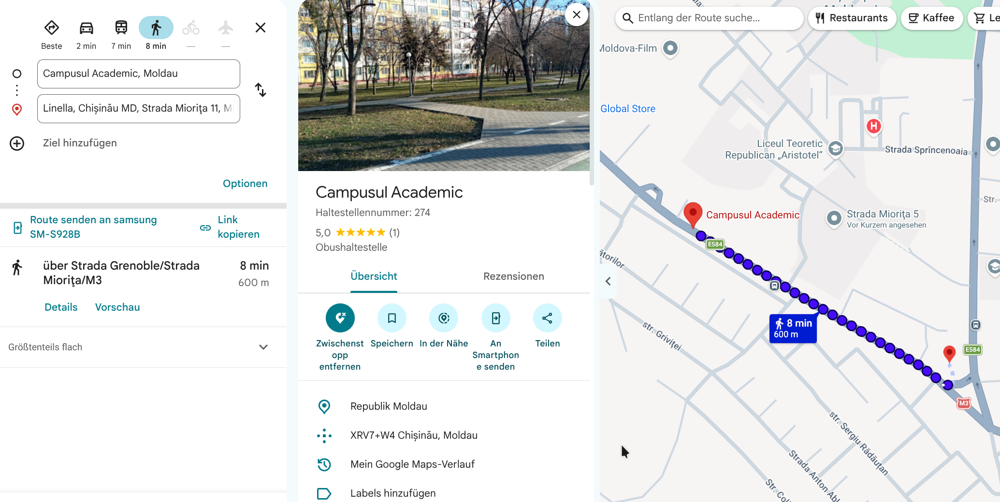
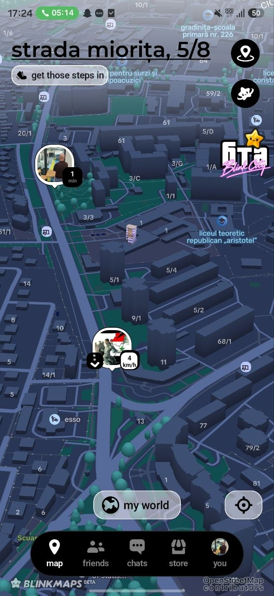
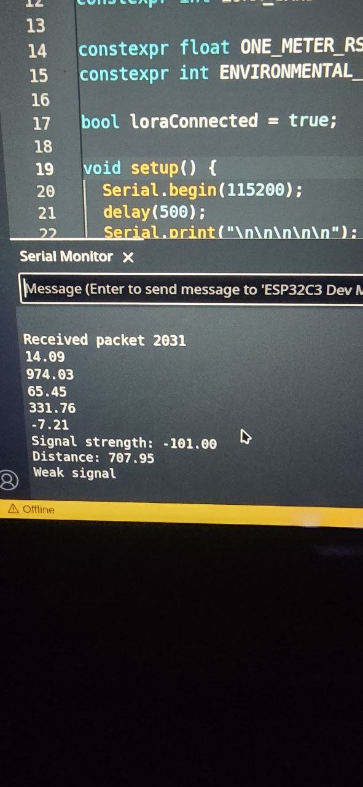

# First LoRa Test (November 18th 2026)
We had both LoRa modules set up. We still hadn't conducted any tests though, to see if they work well at larger distances (bigger than a few meters).

## The Test
Sebastian Iavorschi and Cristian Zamăneagră will exit school grounds and both go to different set points. From there, the receiving LoRa, which is at Sebastian, will give the approximate distance which we had our code calculate. This whole thing is supposed to test the accuracy of our logarithmic distance formula.

## How it went
Sebastian went to 'Campusul Academic`, which is near the school. Cristi went to the Linella nearby. The distance between these 2 points is 600 meters.

You can also see the same thing on the app 'Blink':

The code gave these values to Sebastian:

## The Results
The distance returned by the code was 707.95 meters. The real distance was about 600 meters. This is a good enough result, with an error of about 15%. This means that the environmental constant needs some tweaking to bring the estimated distance down. The constant was at about 2.3, but we were in a crowded city. The constant should've been closer to 3.