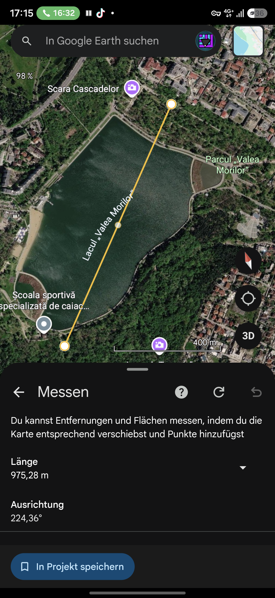
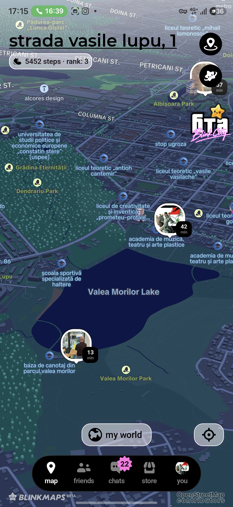
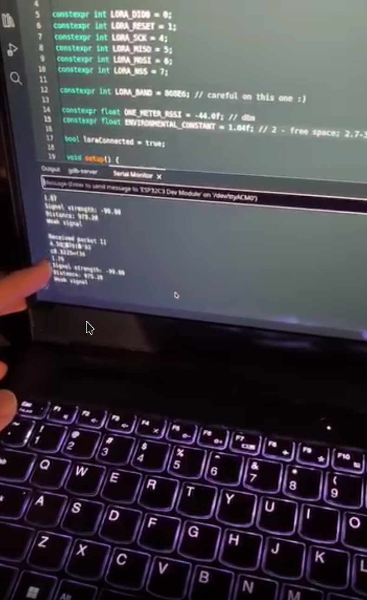

# Second LoRa Test (26th of November 2026)
We had Sebastian and Cristi, along with Mr. Rodas to participate in the second LoRa test. This time it was once again concerned with their communication skills at longer distances, as well as the accuracy of the logarithmic distance formula.

## The Test
We needed to see how the LoRa modules communicate at about 1 km distance. We went on Google Earth, and picked 2 points on the opposite points of the Valea Morilor Park.

Cristi was at the point on top of the picture (Valea Morilor's entrance) and Sebastian along with Mr. Rodas were at the opposite end of the lake (the point on the bottom of the picture).

From here, both plugged in the ESP32-C3 superminis into their laptops and started watching the Serial Monitor

## How it went
The experiment didn't go as planned. It displayed a distance of about 1400m. The culprit turned out to be this line of code `constexpr int ENVIRONMENTAL_CONSTANT = 2.3` in the `Remote.ino` script. Can you see what's wrong? You should have noticed that we are using $2.3$ as the value, but the variable is an integer, meaning that it will end up as simply $2$. We ended up correcting the line to `constexpr float ENVIRONMENTAL_CONSTANT = 2.3f`. We ended up tweaking the constant a few times, ending up with `constexpr float ENVIRONMENTAL_CONSTANT = 1.84f`.

## Results
The code gave us back 975m, exactly the real distance. We tweaked the constant to $1.84$. We now had the LoRa module fully working and calculating the distance between it and the other LoRa module.

It is a bit hard to read, but it says `Distance: 975 m`.