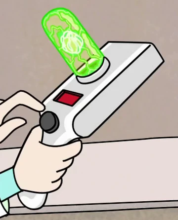

# Remote
The receiver will act like a remote.

This is the inspiration for our remote.

# Description and how it came to be
At first, we realized that we needed a second ESP32, along with its own LoRa module, so that it could send data from the satellite. This idea evolved over time, with us wanting something bigger.

The first change was the beeper we added, to beep faster the closer you are to the satellite. We even came up wtih a test, in which somebody would hide the satellite and the other person would have to find it using the beeper (the remote also tells you the distance to the satellite, so that helps too). This was added since last year during CanSat, around 2-3 satellites simply got lost, and we wanted a robust finding system.

The next change was fully turning it into an actual remote, with buttons and a screen. It will have buttons to turn the satellite on/off, the buzzer, itself and so on. It will also have a small display, which tells you the distance to the satellite.

Another great idea of ours was adding a BMI sensor. The person will move, and when the satellite detects that you're moving towards the satellite, and lock in the correct direction. It will then tell you if you're going the right direction using traffic light LEDs.

# Remote functions
* A turn on/off button for the satellite
* A turn on/off button for the remote
* A turn on/off button for the buzzer (which indicates through sound how far away you are from the satellite)
* A small screen that displays how far away you are from the satellite
* LEDs that tell you if you are looking at the satellite (kind of like a compass)